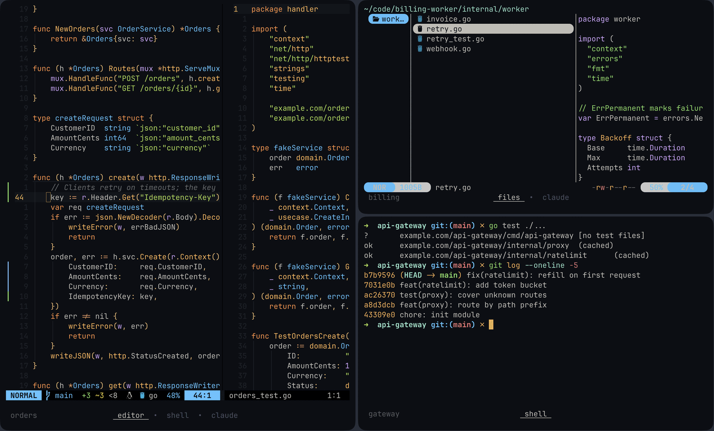
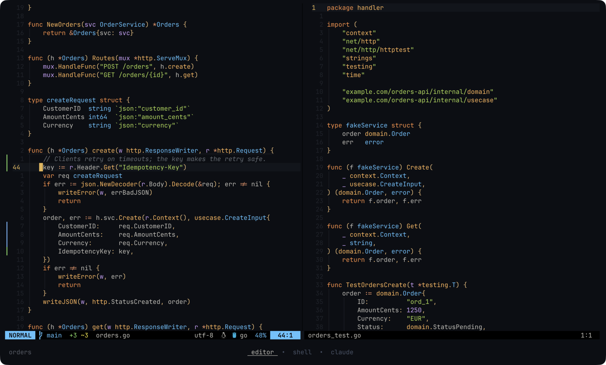
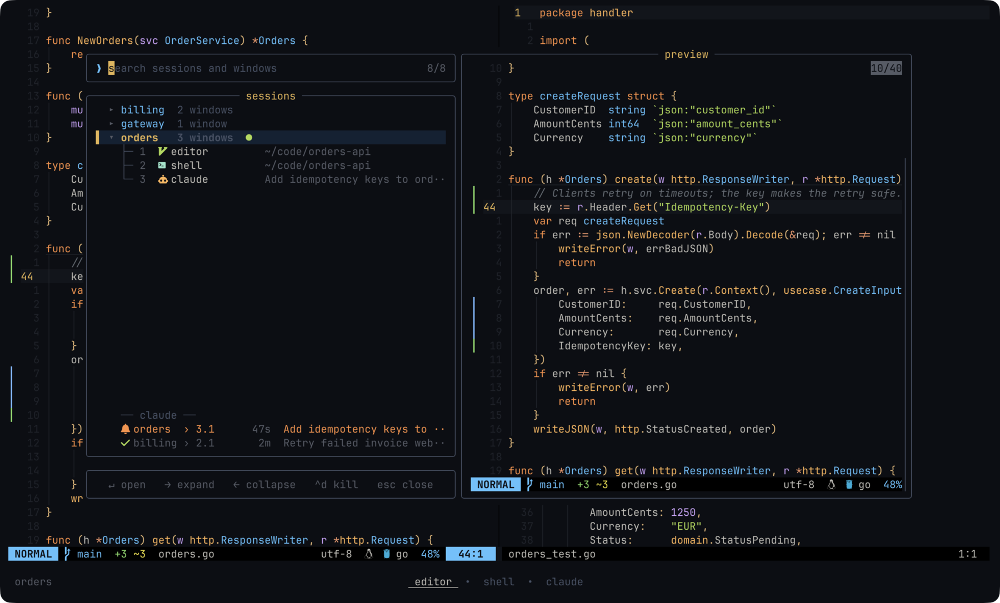
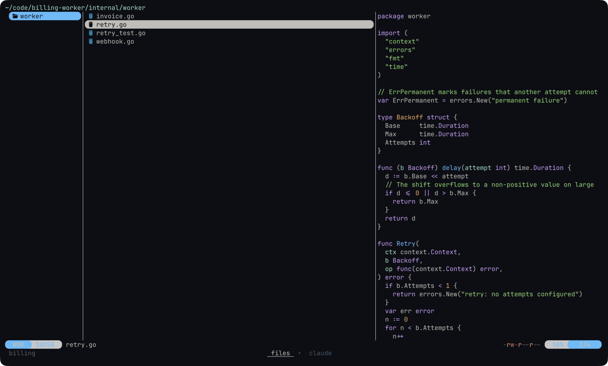

# dotfiles

Configs for a macOS workstation (Ghostty, AeroSpace, Karabiner-Elements,
Neovim, tmux, zsh, Starship, Yazi) and for Linux servers (zsh, tmux, Neovim,
Starship). `install.sh` installs the tools and symlinks the configs into
`$HOME` and `~/.config`; the links point into this repo, so edits in the repo
are live.

With Claude Code installed, `/setup-dotfiles` in a Claude Code session opened
in `~/dotfiles` walks through the setup below: it checks the requirements,
moves existing configs aside, runs `install.sh` and lists the first-run
steps that are left. `/setup-dotfiles update` does the same with
`install.sh --update`.

## Screenshots

The projects, sessions and shell history in these shots are a made-up demo.

AeroSpace tiling three Ghostty windows: Neovim, Yazi and a shell with the
Starship prompt.



Neovim inside tmux: a Go handler next to its test, gitsigns marks in the
gutter, lualine at the bottom.



`prefix + s`: the session tree popup; Claude panes waiting on you or finished
in the last 10 minutes are listed at the bottom.



Yazi with a code preview.



## Requirements

- macOS: Apple Silicon only (the official Homebrew installer aborts on Intel
  since 2026-09-04), an admin account.
- Linux: Ubuntu 24.04+, Debian 13+ or Fedora 42+; x86_64 or arm64; a user with
  sudo. On older releases tmux < 3.3 rejects `allow-passthrough`, glibc < 2.39
  cannot run the prebuilt tree-sitter CLI on arm64 (no highlighting in
  Neovim), and fzf < 0.48 falls back to the packaged key bindings. That
  file is missing on minimized images (e.g. Ubuntu Docker images exclude
  `/usr/share/doc`), where fzf's Ctrl+R / Ctrl+T bindings are then absent.
  RHEL/Rocky/Alma are not supported (stow, fzf, ripgrep live in EPEL).
- The checkout must be exactly at `~/dotfiles`: every link and Stow call
  assumes that path.
- Internet access (packages, Neovim plugins, language servers).
- The run is interactive:
  - macOS: the Homebrew installer asks for your sudo password and waits for
    RETURN, the Karabiner-Elements package asks for the sudo password, and
    `chsh` asks for your user password if the login shell is not zsh yet.
  - Linux: `sudo` asks for your password (packages, `/usr/local`, default
    shell).

## Before you start: existing configs

`install.sh` backs up the Claude Code and Codex files described below:

- `~/.config/karabiner` is deleted (macOS).
- `~/.zshenv` is overwritten.
- `~/.tmux.conf` and `~/.config/starship.toml` are replaced by links.
- In `~/.claude/`, an entry named like one in `claude/` is replaced by a link:
  one directory link per skill under `claude/skills/` (`mac-*` skills on macOS
  only), one file link per file in `claude/agents/`, `claude/hooks/` and
  `claude/bin/`, plus `statusline.sh` and `themes/ayu.json`. A real skill
  directory that holds files is skipped with a message instead.
- macOS: `~/.claude/CLAUDE.md` and `~/.claude/settings.json` become links too;
  a regular file there is first moved to `~/.claude/backups/<name>.<timestamp>`.
- macOS: in the Zen profile named by
  `~/Library/Application Support/zen/installs.ini`, `user.js` and
  `chrome/userChrome.css` become links; a regular file there is skipped
  with a message. Without a profile (Zen never started) the step is skipped.
- Linux: the `statusLine` and `theme` keys in `~/.claude/settings.json` are
  overwritten (Claude Code status line and color theme).
- Stow links into `~/.config/nvim`, `~/.config/zsh`, `~/.config/yazi` and, on
  macOS, `~/.config/ghostty`, `~/.config/aerospace`, `~/.config/topgrade`. If
  one of them already holds a regular file where the repo wants a link, Stow
  reports a conflict and the run aborts.

Before the first install only, move every existing non-symlink path aside
(POSIX sh, works in bash and zsh). Skip this on a machine already set up with
these dotfiles: there `~/.config/nvim`, `~/.config/zsh` and `~/.config/yazi`
are real directories holding Stow links and would be moved needlessly. Each
run writes into its own timestamped directory under `~/dotfiles-backup/`:

```sh
backup=~/dotfiles-backup/$(date +%Y%m%d-%H%M%S)
mkdir -p "$backup"
for p in ~/.zshenv ~/.tmux.conf ~/.config/starship.toml \
  ~/.config/nvim ~/.config/zsh ~/.config/yazi \
  ~/.config/ghostty ~/.config/aerospace ~/.config/karabiner ~/.config/topgrade \
  ~/.claude/agents/implementer.md ~/.claude/agents/plan-reviewer.md \
  ~/.claude/agents/acceptance-validator.md ~/.claude/agents/skill-dry-run.md \
  ~/.claude/hooks/notify.sh ~/.claude/hooks/pane-state.sh \
  ~/.claude/hooks/bash-guard.py ~/.claude/hooks/git-commit-guard.py \
  ~/.claude/hooks/no-em-dash.sh ~/.claude/hooks/skill-note-sync.sh \
  ~/.claude/bin/settings-edit.sh ~/.claude/statusline.sh \
  ~/.claude/themes/ayu.json; do
  if [ -e "$p" ] && [ ! -L "$p" ]; then
    mv "$p" "$backup"/ && echo "moved $p"
  fi
done
```

Also on macOS:

- A Ghostty config in `~/Library/Application Support/com.mitchellh.ghostty/`
  overrides the one from this repo: move it away.
- Apps or fonts you installed by hand earlier (Ghostty, Karabiner-Elements,
  AeroSpace, JetBrains Mono Nerd Font) are kept: the cask install prints
  "Skipping ..." and the run goes on.

## Install

### macOS

1. Install the Xcode Command Line Tools (they provide git for the clone):

   ```sh
   xcode-select --install
   ```

2. Clone and run:

   ```sh
   git clone https://github.com/scv3lqq/dotfiles.git ~/dotfiles
   cd ~/dotfiles && ./install.sh
   ```

The script installs Homebrew if missing, the formulae and casks listed below,
links the configs, clones TPM, writes `ZDOTDIR` into `~/.zshenv`, switches the
default shell to zsh, links the Claude Code config from `claude/` (instructions,
settings, skills, agents, hooks, status line, color theme), and sets up
commit signing for this repo when `~/.ssh/id_ed25519.pub` exists.

### Linux

1. Install git:

   ```sh
   sudo apt-get update && sudo apt-get install -y git   # Ubuntu, Debian
   sudo dnf install -y git                              # Fedora
   ```

2. Clone and run:

   ```sh
   git clone https://github.com/scv3lqq/dotfiles.git ~/dotfiles
   cd ~/dotfiles && ./install.sh
   ```

The script installs the apt or dnf packages listed below plus Neovim,
the tree-sitter CLI and Starship, links the configs, clones TPM, writes
`ZDOTDIR` into `~/.zshenv`, switches the default shell to zsh (`sudo usermod`,
no password prompt from `chsh`), links the Claude Code skills, agents, hooks,
status line and color theme from `claude/`, and sets up commit signing when
`~/.ssh/id_ed25519.pub` exists.
macOS-only configs are skipped.

`install.sh` is safe to re-run on both systems.

### Codex

Codex shares the personal Claude skills and has native `implementer`,
`plan-reviewer`, `acceptance-validator`, and `skill-dry-run` agents. The agents
inherit the current Codex model; their reasoning efforts match the source roles.
The `feature` and `retro` skills have Codex adapters. Existing third-party skills
and the Go reviewer are preserved.

The installer configures this when Python 3.11+ is available. To preview just
the Codex changes, run `python3 codex/setup.py`; apply them with
`python3 codex/setup.py --apply`. This links guidance and agents into `~/.codex/`,
skills into `~/.agents/skills/`, and the Ayu syntax theme into `~/.codex/themes/`.
It sets only `tui.theme` in the existing `~/.codex/config.toml`; model, permissions,
authentication and integrations remain unchanged. Conflicting skill, agent and
theme files are preserved and reported. Replaced guidance and configuration are
backed up privately under `~/.claude/backups/codex-<timestamp>/`.

Restart Codex after applying. The CLI theme controls syntax highlighting;
terminal background and text follow Ghostty. For the desktop app, use
Settings > Appearance: dark base, background `#0B0E14`, foreground `#E8E6DD`,
accent `#CDA1FA`, and code font `JetBrainsMono Nerd Font`.

Run `just check` for shell syntax, isolated setup tests, and Codex asset checks.

## First run

1. Open a new terminal (macOS) or reconnect (Linux) so zsh is the login shell.
2. tmux plugins: start `tmux`, press `Ctrl+a`, then `Shift+i`.
3. Neovim: start `nvim`. lazy.nvim installs the plugins at the commits pinned
   in `nvim/lazy-lock.json`, nvim-treesitter compiles its parsers, Mason
   installs gopls, basedpyright, ruff, lua_ls and yamlls (only on an
   interactive start, not with `--headless`), and go.nvim installs its Go
   tools. The first start takes several minutes.
   - If nvim stops at "Press ENTER or type command to continue" during the
     first start, press Enter: the installs wait until you do.
   - The bootstrap in `nvim/init.lua` clones lazy.nvim from its `stable`
     branch, so the first start always rewrites the lazy.nvim line of
     `nvim/lazy-lock.json`, and `:Lazy restore` alone does not undo that (it
     reads the rewritten lock). After the first start, quit nvim and run the
     following so lazy.nvim matches the lock and the checkout stays clean;
     later starts do not touch the lock:

     ```sh
     git -C ~/dotfiles checkout nvim/lazy-lock.json
     nvim --headless "+Lazy! restore" +qa
     ```

     `~/dotfiles/install.sh --update` performs the same fix, so running it
     once after the first start is enough.

   - If a build failed because a tool was missing, install the tool and run
     `:Lazy build <plugin>`: lazy.nvim does not retry failed builds.
   - On Linux the markdown-preview.nvim build fails because yarn is not
     installed. That error is expected on servers: ignore it.
4. macOS permissions:
   - Open AeroSpace once and grant Accessibility (System Settings > Privacy &
     Security > Accessibility). Later logins start it via `start-at-login`.
   - Open Karabiner-Elements and follow its setup: allow its background items
     (System Settings > General > Login Items & Extensions), grant
     Accessibility and Input Monitoring to Karabiner-Core-Service, and
     activate the driver extension.
   - Allow `terminal-notifier` on the first Claude Code alert.
   - Set Ghostty as your terminal.
5. SSH from Ghostty to a server: copy Ghostty's terminfo once, otherwise tmux
   on the server fails with "missing or unsuitable terminal: xterm-ghostty":

   ```sh
   infocmp -x xterm-ghostty | ssh <host> -- tic -x -
   ```

6. Commit signing (repo owner only). `install.sh` configures it only when
   `~/.ssh/id_ed25519.pub` exists (and git is 2.34+). To set it up, create the
   key and authorize `gh` (on macOS the first run installs `gh`; Linux does
   not install it, so the key upload is skipped there), then re-run
   `./install.sh` to upload the key to GitHub:

   ```sh
   ssh-keygen -t ed25519
   gh auth login
   gh auth refresh -h github.com -s admin:ssh_signing_key
   cd ~/dotfiles && ./install.sh
   ```

   The step sets this repo's `user.email` to the author of the last commit.
   Anyone else either sets their own address afterwards with
   `git -C ~/dotfiles config user.email <you>` or skips signing by not having
   `~/.ssh/id_ed25519.pub`. The owner switches the remote to SSH to push:
   `git -C ~/dotfiles remote set-url origin git@github.com:scv3lqq/dotfiles.git`.
7. Optional, macOS: Claude Code is not installed by the script. If you use it,
   it picks up the Stop hook; restart it after `install.sh` (it may rewrite
   `~/.claude.json` from memory).

## What gets installed

### macOS (Homebrew)

Formulae:

- `stow`: links the configs.
- `neovim`, `tmux`, `starship`, `yazi`: the editor, multiplexer, prompt and
  file manager (`y`).
- `zsh-fast-syntax-highlighting`, `zsh-autosuggestions`, `zsh-completions`:
  zsh plugins loaded by `zsh/.zshrc`.
- `fzf`: shell key bindings, `nf`, `gcof`, `fkill`, tmux `prefix + s`.
- `fd`, `bat`, `eza`: fzf file lists and previews.
- `ripgrep`: Telescope live grep.
- `tree-sitter-cli`: nvim-treesitter parser builds.
- `go`, `node`: Mason servers (gopls, yamlls) and go.nvim tools.
- `yarn`: markdown-preview.nvim build (`:MarkdownPreview`).
- `lazygit`, `lazydocker`: `<leader>gg` in Neovim, `lzd`.
- `topgrade`: daily updates (see [Updating](#updating)).
- `terminal-notifier`: the Claude Code Stop hook alert.
- `jq`: `install.sh` edits the Claude Code settings with it.
- `gh`: uploads the commit signing key.

Casks: `ghostty`, `karabiner-elements`, `font-jetbrains-mono-nerd-font`,
`nikitabobko/tap/aerospace`, `claudebar` (Claude usage limits in the menu bar).

### Linux

apt (Ubuntu, Debian):

- `stow`, `zsh`, `tmux`, `zsh-autosuggestions`: links, shell, multiplexer.
- `curl`, `git`, `jq`: install steps.
- `fzf`: shell key bindings, `nf`, `gcof`, `fkill`, tmux `prefix + s`.
- `ripgrep`: Telescope live grep.
- `make`, `gcc`: plugin builds (telescope-fzf-native, go.nvim helpers,
  tree-sitter parsers).
- `unzip`, `python3-venv`, `nodejs`, `npm`, `golang-go`: Mason servers and
  go.nvim tools.

dnf (Fedora): the same set with Fedora names: `stow`, `zsh`, `curl`, `git`,
`jq`, `tmux`, `fzf`, `ripgrep`, `make`, `gcc`, `unzip`, `python3`, `nodejs`,
`npm`, `golang`, `zsh-autosuggestions`.

Outside the package manager:

- Neovim: the latest release tarball for the machine's architecture, unpacked
  into `/usr/local` when `nvim` is missing or older than 0.11.3 (the config
  needs 0.11.3+, distro packages are older).
- tree-sitter CLI: the latest release binary into `/usr/local/bin` when no
  working `tree-sitter` is found; removed again if the download failed or the
  binary cannot run (glibc < 2.39).
- Starship: the official install script, when `starship` is missing.

### Not installed on Linux

fd, bat, eza, yazi, lazygit, lazydocker, fast-syntax-highlighting, yarn. So
`y`, `lzd`, `<leader>gg`, the fzf previews and `:MarkdownPreview` are not
available on servers, and the markdown-preview.nvim build error on the first
`nvim` start is expected: ignore it.

### Install by hand (macOS)

| App | Purpose |
|---|---|
| [Zen](https://zen-browser.app) | Browser; start it once before `install.sh` so the theme in `zen/` gets linked |
| [Obsidian](https://obsidian.md) | Notes |
| [Telegram](https://telegram.org) | Messenger |
| [Spotify](https://spotify.com) | Music |

## Layout

| Path | Linked to | Notes |
|---|---|---|
| `nvim/` | `~/.config/nvim` | lazy.nvim, plugin specs in `nvim/lua/plugins/` |
| `zsh/` | `~/.config/zsh` | `install.sh` writes `ZDOTDIR` into `~/.zshenv`, so `~/.zshrc` and `~/.zprofile` are unused |
| (none) | `~/.zshenv` | written (not linked) by `install.sh`: `export ZDOTDIR="$HOME/.config/zsh"` |
| `yazi/` | `~/.config/yazi` | file manager |
| `ghostty/`, `aerospace/`, `karabiner/`, `topgrade/` | `~/.config/*` | macOS only, via Stow |
| `starship/starship.toml` | `~/.config/starship.toml` | prompt |
| `tmux/tmux.conf` | `~/.tmux.conf` | TPM cloned into `~/.tmux/plugins/tpm` |
| `anki/terminal_theme/` | `Anki2/addons21/terminal_theme` | Anki add-on; symlinked by hand, not by `install.sh` (`anki/cards/` holds card templates) |
| `zen/user.js`, `zen/chrome/userChrome.css` | Zen profile | macOS only; terminal look in the Ayu palette, linked into the profile named by `installs.ini`; check it headless with `zen/preview.py` + `zen/checks.jq` |
| `claude/CLAUDE.md`, `claude/settings.json` | `~/.claude/` | macOS only; global Claude Code instructions and settings; the personal part of the instructions is imported from `~/.claude/private/CLAUDE.md`, which stays outside the repo |
| `claude/skills/*/` | `~/.claude/skills/` | one directory link per skill, `/feature` among them; `mac-*` skills on macOS only |
| `claude/agents/*.md`, `claude/hooks/*`, `claude/bin/*`, `claude/statusline.sh`, `claude/themes/ayu.json` | `~/.claude/` | one link per file: the `/feature` agents, the hooks `settings.json` wires (Stop alert, picker state, guards), `settings-edit.sh`, the status line and color theme |
| `.githooks/pre-commit` | | refuses staged lines that match `~/.claude/private/denylist`; `install.sh` sets `core.hooksPath` |
| `.claude/skills/` | | Claude Code skills of this repo: `/setup-dotfiles`, `docs-sync` |
| `notes/`, `plans/`, `everything.md` | | personal notes, implementation plans, Russian cheatsheet |
| `assets/screenshots/` | | README screenshots of a made-up demo, recipe in `plans/readme-screenshots.md` |

Symlinks point directly into the repo: edits are live.

## Updating

```sh
~/dotfiles/install.sh --update
```

It runs `git pull --ff-only` in `~/dotfiles` and, when the pull fails
(diverged branch, local changes in the way, no network), stops with an error
before changing anything else. Then it runs the pulled `install.sh`, which
does everything a plain run does (installs what is missing, re-links the
configs, rewrites `~/.zshenv`) and also:

- macOS: `brew update`, `brew upgrade` of the formulae listed in
  [What gets installed](#what-gets-installed), and `brew upgrade --cask` of
  the listed casks that `brew outdated --cask` reports. Casks installed by
  hand and casks that update themselves (Ghostty) are left alone.
- Linux, apt: the `apt-get install` of the listed packages already upgrades
  them; nothing else on the system is upgraded.
- Linux, dnf: `dnf upgrade` of the listed packages only.
- Linux, outside the package manager: Neovim, the tree-sitter CLI and
  Starship are replaced by their latest GitHub release when it is newer,
  and only when they live in `/usr/local/bin`, where `install.sh` puts them.
- tmux: installs the plugins newly listed in `tmux/tmux.conf` and updates all of
  them. TPM runs against a private tmux server, so your sessions are not
  touched.
- Neovim: restores the plugins to the commits in `nvim/lazy-lock.json`
  (headless `:Lazy restore`, including the lock fix from
  [First run](#first-run), which also runs before the pull), updates the
  tree-sitter parsers and upgrades outdated Mason packages. Plugins never
  move past the lock: `:Lazy update` and `:Lazy sync` rewrite
  `nvim/lazy-lock.json`, so commit the new lock or discard it with
  `git -C ~/dotfiles checkout nvim/lazy-lock.json`. Until then `--update`
  skips this step, and a pull that changes the lock fails.
- Prints the pulled commit range and reminds you to open a new shell (or run
  `tmux-reload`).

It does not upgrade the rest of the system (`apt upgrade`, a full
`dnf upgrade`, other brew formulae, macOS updates) or go.nvim's tools
(`:GoUpdateBinaries`).

A failed package install or Stow conflict stops the run. A failed upgrade or
plugin step prints a `Warning:`, `Skipping` or `Could not` line and the run
goes on to `Done.`, so read the output.

On a checkout older than `--update` the old `install.sh` ignores its
arguments and runs a plain install without pulling, so pull by hand once:

```sh
git -C ~/dotfiles pull --ff-only
~/dotfiles/install.sh --update
```

On a Linux server set up before 2026-10-14 the old installer left
`/usr/local/bin`, `/usr/local/lib` and `/usr/local/share` owned by uid 1001,
and neither mode changes that. If `stat -c '%u:%g' /usr/local/bin` does not
print `0:0`, run
`sudo chown root:root /usr/local/bin /usr/local/lib /usr/local/share`.

On macOS `topgrade` upgrades brew/casks/rust/etc.; a launchd agent at
`~/Library/LaunchAgents/local.topgrade.plist` runs it daily at 22:00.
`system`, `vim`, `git_repos`, `containers` and `colima` steps are disabled on
purpose (`topgrade/topgrade/topgrade.toml`). The agent lives outside the repo
and `install.sh` does not create it; on a new Mac create and load it with:

```sh
mkdir -p ~/Library/LaunchAgents
cat > ~/Library/LaunchAgents/local.topgrade.plist <<EOF
<?xml version="1.0" encoding="UTF-8"?>
<!DOCTYPE plist PUBLIC "-//Apple//DTD PLIST 1.0//EN" "http://www.apple.com/DTDs/PropertyList-1.0.dtd">
<plist version="1.0">
<dict>
	<key>Label</key>
	<string>local.topgrade</string>
	<key>ProgramArguments</key>
	<array>
		<string>/bin/zsh</string>
		<string>-lc</string>
		<string>topgrade</string>
	</array>
	<key>StartCalendarInterval</key>
	<dict>
		<key>Hour</key>
		<integer>22</integer>
		<key>Minute</key>
		<integer>0</integer>
	</dict>
	<key>StandardOutPath</key>
	<string>$HOME/Library/Logs/topgrade.log</string>
	<key>StandardErrorPath</key>
	<string>$HOME/Library/Logs/topgrade.log</string>
</dict>
</plist>
EOF
launchctl bootstrap gui/$(id -u) ~/Library/LaunchAgents/local.topgrade.plist
```

Run the first update by hand in a terminal (`topgrade`); the log of the daily
runs is `~/Library/Logs/topgrade.log`.

---

## tmux

Prefix is `Ctrl+a`. The config needs tmux 3.3+.

| Key | Action |
|---|---|
| `prefix` + `c` | New window in the current path |
| `prefix` + <code>&#124;</code> / `-` | Split horizontally / vertically |
| `prefix` + `h/j/k/l` | Resize pane (repeatable) |
| `prefix` + `m` | Zoom pane |
| `prefix` + `s` | Session tree popup (fzf): `→` expand, `←` collapse, `Enter` opens the session's first window or the focused window, `Ctrl+d` kills the session or window; Claude panes mid-turn (working, or waiting on you) or waiting on background agents are listed live at the bottom, panes whose turn finished in the last 10 minutes below them, `Enter` jumps to the pane; tmux `choose-tree` when fzf < 0.73 |
| `prefix` + `r` | Reload `~/.tmux.conf` |
| `prefix` + `C-l` | Clear screen (`Ctrl+l` itself is taken by vim-tmux-navigator) |
| `Ctrl+h/j/k/l` | Move between nvim splits and tmux panes (vim-tmux-navigator) |
| `v` / `y` in copy mode | Start selection / copy and leave copy mode (vi keys) |
| `prefix` + `C-s` / `C-r` | Save / restore sessions (tmux-resurrect) |

Plugins: tpm, vim-tmux-navigator, tmux-sessionist, tmux-dotbar, tmux-resurrect,
tmux-continuum, tmux-assistant-resurrect (restores AI assistant sessions).

tmux-continuum saves the sessions every 5 minutes and restores them when tmux
starts. tmux-assistant-resurrect writes SessionStart/SessionEnd hooks into
`~/.claude/settings.json` (and `~/.cursor/hooks.json`) on every tmux start,
on servers too.

## AeroSpace keybindings

| Key | Action |
|---|---|
| `Alt + h/j/k/l` | Focus window |
| `Alt + Shift + h/j/k/l` | Move window |
| `Alt + Shift + -` / `Alt + Shift + =` | Resize window ±50 |
| `Alt + 1-9` | Switch workspace |
| `Alt + w/t/s/m/o/g/p` | Switch to named workspace |
| `Alt + Shift + 1-9` | Move window to workspace |
| `Alt + Tab` | Previous workspace |
| `Alt + Shift + Tab` | Move workspace to next monitor |
| `Alt + /` | Toggle tiles layout |
| `Alt + ,` | Toggle accordion layout |
| `Alt + Enter` | Open Ghostty |
| `Alt + b` | Open Zen |
| `Alt + z` | Open Obsidian |
| `Alt + Shift + ;` | Service mode |

Auto workspace assignment: Ghostty → `t`, Zen → `w`, Spotify → `s`,
Telegram → `m`, Obsidian → `o`, Chrome → `g`.

## Karabiner

- Right Control + `h/j/k/l` send the arrow keys; any other modifiers held
  with them pass through.
- Caps Lock is remapped to Right Control only for two specific keyboards: the
  owner's MacBook Air internal keyboard (vendor 1452, product 641) and an
  external one (vendor 1241, product 661). On other keyboards add the Caps
  Lock remap in Karabiner-Elements > Simple Modifications with that keyboard
  selected as the target device.

## Shell

| Alias | |
|---|---|
| `n` / `nf` | nvim / nvim via fzf |
| `y` | yazi, cd's to the directory you exit in |
| `gst` / `gp` / `gpl` | git status / push / pull |
| `gl` | git log, graph + decorations |
| `gcof` | checkout branch via fzf |
| `lzd` | lazydocker |
| `md` | mkdir -p |
| `fkill` | kill process via fzf |
| `tmux-reload` | re-source `.zshrc` in every tmux pane |

`ll`, `la`, `..`, `...` and the fzf previews (`bat` for files, `eza --tree` for
directories) come from `zsh/.zshrc`.

## Verifying config changes

Run from `~/dotfiles`:

```sh
bash -n install.sh                                     # installer syntax
zsh -n zsh/.zshrc zsh/.zprofile zsh/aliases.zsh        # zsh syntax
ghostty +validate-config                               # Ghostty config
find nvim -name '*.lua' -print0 | xargs -0 -n1 luac -p # Lua parse
find nvim karabiner -name '*.json' -print0 | xargs -0 -n1 jq empty
tmux source-file ~/.tmux.conf                          # apply + validate tmux
aerospace reload-config --dry-run                      # AeroSpace config
uv run zen/preview.py --out /tmp/zen.png && jq -e -r -f zen/checks.jq /tmp/zen.json # Zen theme, headless
```

- `tmux source-file` must run inside a tmux session.
- `luac` is not installed by the script: `brew install lua`.
- `./install.sh` mutates `$HOME`, so it is not a check: run it only to
  provision or update (`--update`).
